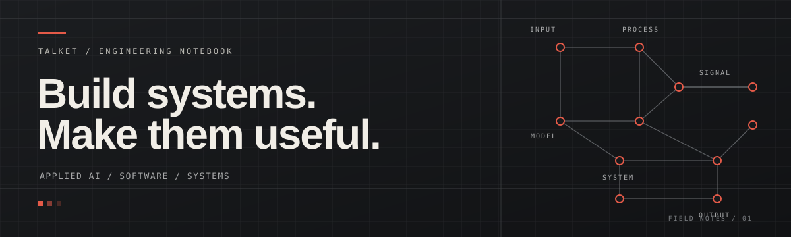

  

  <strong>COMPUTER SCIENCE · AI/ML · SOFTWARE ENGINEERING</strong>

<h1 align="center">I build systems, not just demos.</h1>

  I’m Talket — a Computer Science and Engineering student focused on AI/ML. 
  I enjoy taking a problem from messy inputs to a working tool: data, models, APIs, 
  interfaces, and the engineering that makes the pieces work together.

  <a href="https://github.com/Talket">GitHub</a>
  &nbsp;·&nbsp;
  <a href="https://github.com/Talket/Portfolio">Portfolio source</a>
  &nbsp;·&nbsp;
  <a href="https://github.com/Talket?tab=repositories">All repositories</a>

---

### THE WORK

| 01 — Applied intelligence | 02 — Product engineering | 03 — Systems thinking |
|:--|:--|:--|
| Similarity analysis, machine learning, document intelligence, model evaluation. | Web and mobile applications, APIs, data-backed workflows, usable interfaces. | Concurrency, databases, edge workloads, deployment, reliability and trade-offs. |

### SELECTED BUILD

**[Syllabus Similarity & Curriculum Novelty Detection](https://github.com/Talket/syllabus-similarity)**

A tool for comparing course syllabi, finding related courses, examining unit-level overlap, and identifying what appears new. The repository includes a Python analysis workflow and a React-based interface.

<code>Python</code> · <code>NLP / embeddings</code> · <code>Streamlit</code> · <code>React</code> · <code>TypeScript</code>

### OTHER THINGS I WORK ON

- **Mobile products** — Flutter applications backed by Firebase and edge AI services.
- **Business software** — real-time operational workflows, role-based interfaces, billing and data synchronization.
- **Document intelligence** — OCR/HTR pipelines, visual analysis and resource-constrained edge processing.
- **Computer science experiments** — algorithms, concurrency and practical automation.

Some product and research work is private or not yet published. I prefer to share a project when its documentation and data are ready to be reviewed.

### TOOLBOX

**Languages**  
<code>Python</code> <code>TypeScript</code> <code>JavaScript</code> <code>C++</code> <code>Dart</code> <code>Java</code> <code>SQL</code>

**AI / data**  
<code>Machine Learning</code> <code>Deep Learning</code> <code>Computer Vision</code> <code>NLP</code> <code>Model Evaluation</code>

**Engineering**  
<code>React</code> <code>Flutter</code> <code>FastAPI</code> <code>Firebase</code> <code>REST APIs</code> <code>Docker</code> <code>Git</code>

### CURRENT APPROACH

I care about the parts between a working model and a useful product: data quality, clear interfaces, reliable APIs, resource limits, evaluation, and deployment.

I don't measure a project by how many tools it lists. I measure it by what it does, how it behaves, and whether someone else can understand and run it.

---

  BUILD LOG / EXPERIMENTS / ITERATIONS — Updated as the work evolves.

