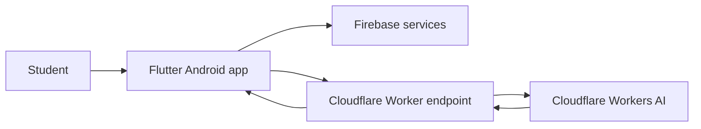

# After 12th — Career Guidance

  <strong>PRODUCT / ANDROID / APPLIED AI</strong> 
  <em>A career-guidance product for the decisions that follow Class 12.</em>

**Status:** Published on Google Play  
**Platform:** Android  
**Product area:** Education · Career discovery · AI-assisted guidance

[Open the Google Play listing](https://play.google.com/store/apps/details?id=com.after12th.careerguide)

---

## 01 / The product

After 12th helps students explore what they can do after completing Class 12. It brings career paths, courses, degree options, entrance-exam information and supporting guidance into one mobile experience.

The problem it addresses is not a lack of information. It is that useful information is spread across many places, while students are expected to make high-impact decisions with little structure.

The app organizes that exploration into a more accessible, student-oriented flow and adds an AI-assisted question experience.

## 02 / Product capabilities

- Explore career options across Science, Commerce and Arts streams.
- Browse career paths, courses, degrees and related entrance examinations.
- Access supporting educational resources and guidance.
- Use an AI-assisted experience for follow-up questions.
- Use an Android-first interface designed for students.

## 03 / Engineering notes

| Area | Implementation |
|---|---|
| Mobile client | Flutter · Dart |
| Identity and application data | Firebase |
| AI integration | Cloudflare Workers AI through a Worker-backed endpoint |
| Distribution | Google Play |
| Monetization integration | Google Mobile Ads / AdMob |

### Simplified system view

This is a product-level view, not a complete deployment diagram. It deliberately avoids exposing credentials, private endpoints or internal implementation details.

## 04 / My engineering work

My work on the product includes the Android client, the integration between mobile features and backend services, the AI-assisted interaction path, and the release process.

The main engineering concern is making guidance useful inside a constrained mobile experience: the information needs structure, the AI layer needs a controlled integration boundary, and the app needs to remain usable on real Android devices.

## 05 / What I learned

- A useful education product needs organized and maintainable information, not just a chat interface.
- AI responses need to complement curated content rather than replace factual educational information.
- Mobile releases involve more than implementation: compatibility, permissions, store requirements and post-release maintenance matter.

## 06 / Source availability

The application source code is not published in this repository. This page is a product and engineering case study; it does not claim that the app is open source.

For a reproducible technical review, share only sanitized architecture diagrams, screenshots and implementation details that do not expose private keys, API tokens, user data or proprietary code.

---

ENGINEERING FIELD NOTES / PRODUCT 01
