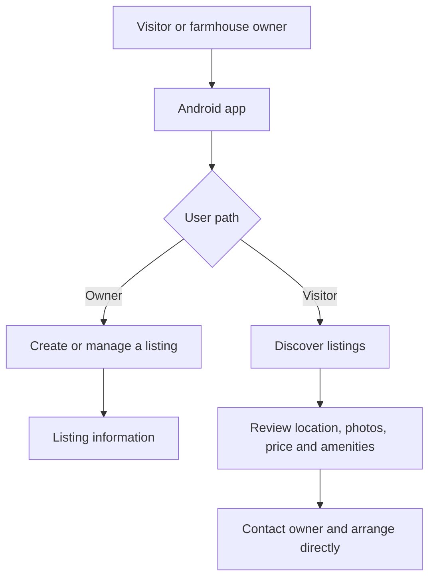

# FarmHouse Chalo — Farmhouse Discovery Marketplace

  <strong>PRODUCT / ANDROID / MARKETPLACE</strong> 
  <em>Connecting farmhouse owners with people looking for a place to stay or spend time.</em>

**Status:** Android product released  
**Platform:** Android  
**Product area:** Local discovery · Property listings · Marketplace

[Search FarmHouse Booking on Google Play](https://play.google.com/store/search?q=FarmHouse%20Booking&c=apps)  
[Public privacy policy and terms repository](https://github.com/Talket/farmhouse_booking)

---

## 01 / The product

FarmHouse Chalo is a marketplace-style mobile product that connects farmhouse owners with users interested in discovering and arranging farmhouse stays.

The product documentation describes two main sides of the experience:

- **Visitors:** discover listings and review the property information before contacting the owner.
- **Owners:** create an account and submit farmhouse listings with the information a visitor needs to evaluate a property.

The platform is a discovery and connection layer. Its published terms explain that booking discussions, payment arrangements and agreements are handled directly between the user and the farmhouse owner unless the app explicitly introduces an in-app process.

## 02 / Product capabilities

- User accounts and authentication.
- Owner-submitted farmhouse listings.
- Listing information such as location, photographs, pricing, amenities, rules and availability.
- Location-aware discovery, with optional device-location access.
- Property information and map/direction support.
- Advertising placements documented for Google AdMob.

## 03 / Engineering notes

| Area | Implementation |
|---|---|
| Mobile client | Flutter · Dart |
| Authentication | Firebase Authentication |
| Location experience | Permission-based device location and map/direction support |
| Monetization integration | Google AdMob |
| Public product documentation | Privacy policy and terms in the linked repository |

### Simplified product flow

This diagram describes the documented product flow. It is not a claim that the app processes or guarantees bookings or payments inside the application.

## 04 / My engineering work

My work on the product includes the Flutter application experience and the integration of app services needed for account access, farmhouse listings, location-aware discovery and monetization.

A key product-design requirement is to make the responsibilities clear: FarmHouse Chalo provides a discovery platform, while owners remain responsible for the accuracy of their listings and users should verify property details directly before making arrangements.

## 05 / Public documentation

The separate `farmhouse_booking` repository contains public-facing legal documentation:

- [Privacy policy](https://github.com/Talket/farmhouse_booking/blob/main/privacy-policy.html)
- [Terms and conditions](https://github.com/Talket/farmhouse_booking/blob/main/terms-and-conditions.html)

That repository is a documentation repository, **not the application's source-code repository**.

## 06 / Source availability

The application source code is not published here. This case study documents the product and the engineering areas involved without exposing private implementation code, production credentials or user data.

---

ENGINEERING FIELD NOTES / PRODUCT 02
